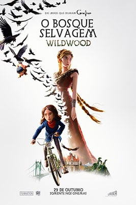

**O Bosque Selvagem** (*Wildwood*, no original) é a nova animação em stop-motion dos Estúdios LAIKA, os mesmos de *Coraline e o Mundo Secreto*. O filme estreia em **29 de outubro de 2026** nos cinemas brasileiros, com distribuição da Imagem Filmes. A direção é de **Travis Knight**, CEO do estúdio e diretor de *Kubo e as Cordas Mágicas*. Esta matéria é uma prévia, feita a partir do material oficial de divulgação, e ainda não é uma crítica.

## Sobre o que é O Bosque Selvagem

A história acompanha **Prue McKeel**, uma adolescente determinada de Portland, no Oregon. Quando o irmão bebê, Mac, é levado por um bando de corvos, ela parte para resgatá-lo com o colega de classe **Curtis Mehlberg**.

O destino dos dois é a Floresta Impassável, um bosque escondido logo depois da cidade, que não aparece em mapa algum e de onde dizem que ninguém volta. Lá dentro, eles encontram animais falantes, bandidos e figuras poderosas. Segundo a sinopse oficial, o irmão de Prue foi enviado ao bosque por uma feiticeira que precisa dele para seus planos.

Por baixo da aventura, o filme fala de coragem, amizade e dos laços que nos unem. Para Knight, o livro trata também de luto e de amor, e da tensão entre se segurar e deixar partir.

## Do livro ao cinema: 16 anos de espera

O filme é uma adaptação do livro *Wildwood*, de **Colin Meloy**, escritor e vocalista da banda The Decemberists, com ilustrações de **Carson Ellis**. Em 2010, antes de o livro ser publicado, Meloy mostrou o manuscrito a Travis Knight. A obra saiu quatro anos depois e entrou na lista de best-sellers do *New York Times*.

Knight conta que se apaixonou na hora: "Eu me apaixonei imediatamente. Era extraordinário." A LAIKA fechou um acordo com os autores para adaptar a história em stop-motion. Só que, nas palavras do diretor, o estúdio descobriu que não sabia como fazer o filme.

O projeto esperou. Nesse intervalo, a LAIKA lançou outros longas, e Knight diz que só então o estúdio se tornou capaz de contar essa história. "Estou fazendo este filme a minha vida toda", resume o diretor, que fala em 16 anos desde o primeiro contato com o livro.

## Como o filme foi feito

A produção começou de fato em 2021, com mais de mil artistas, artesãos e técnicos. O roteiro é de **Chris Butler**, que já assinou *ParaNorman*, *Kubo e as Cordas Mágicas* e *Link Perdido*, e que adapta um livro pela primeira vez.

Os números divulgados pela produção impressionam:

- mais de 1.155 dias de trabalho, do início ao fim da produção;
- 2.804 planos na versão final;
- 132 cenários físicos, construídos para o filme;
- 233 bonecos, com 142.030 rostos substituíveis, trocados quadro a quadro para criar as expressões.

Na equipe criativa, **Thibault Leclercq** lidera o design dos personagens, **Deb Cook** assina o figurino e **Nelson Lowry** cuida da direção de arte, com cenários inspirados em Portland, cidade-sede da LAIKA. A fotografia é de **Caleb Deschanel**, seis vezes indicado ao Oscar, que faz aqui sua primeira animação em stop-motion.

O Brasil também aparece nos bastidores. O animador **Thiago Calçado**, natural de Uberaba (MG), integrou a equipe. Ele já havia trabalhado com Knight em *Kubo e as Cordas Mágicas* e também integrou a equipe de *Pinóquio* (2022), de Guillermo del Toro.

Para Knight, a técnica não é o ponto. "Nosso filme foi feito à mão, um quadro por vez", afirma, e o objetivo é que o público esqueça o trabalho por trás e acredite na vida diante dele.

## Elenco e dublagem

No Brasil, **Giulia Benite**, de *Turma da Mônica: Laços*, dubla a protagonista Prue. No original em inglês, Prue é interpretada por **Peyton Elizabeth Lee** e Curtis por **Jacob Tremblay**. O estúdio também anunciou, entre outros nomes, **Carey Mulligan**, **Mahershala Ali**, **Awkwafina**, **Angela Bassett**, **Jemaine Clement**, **Richard E. Grant** e **Tom Waits**.

## Ficha técnica

*Pôster de O Bosque Selvagem. Divulgação/Imagem Filmes.*

- **Direção:** Travis Knight
- **Roteiro:** Chris Butler
- **Produção:** Travis Knight e Sam Wilson
- **Direção de fotografia:** Caleb Deschanel
- **Direção de arte:** Nelson Lowry
- **Montagem:** Christopher Murrie-Green
- **Música:** Dario Marianelli
- **Figurino:** Deborah Cook
- **Design principal de personagens:** Thibault Leclercq
- **Chefia de animação:** Brad Schiff
- **Distribuição no Brasil:** Imagem Filmes

## Primeiras reações

A première mundial foi em 11 de outubro, no BFI London Film Festival. Depois disso, o filme seguiu para outros festivais, como o Alice nella Città, em Roma, e o Festival Internacional de Cinema de Morelia, no México.

Segundo o material de divulgação, o longa estreou no Rotten Tomatoes com 100% de aprovação. A *The Hollywood Reporter* o chamou de projeto mais ambicioso da LAIKA e talvez sua obra-prima. O britânico *The Telegraph* escreveu: "Acho que acabei de ver o filme em stop-motion mais bonito já feito". São reações iniciais, e as notas costumam mudar quando mais críticas são publicadas.

## O histórico da LAIKA

Fundada em 2005, perto de Portland, a LAIKA lançou cinco longas antes deste. *Coraline e o Mundo Secreto* (2009), *ParaNorman* (2012), *Os Boxtrolls* (2014), *Kubo e as Cordas Mágicas* (2016) e *Link Perdido* (2019) foram todos indicados ao Oscar de Melhor Animação.

*Kubo* venceu o BAFTA de Melhor Filme de Animação e concorreu ao Oscar de Efeitos Visuais. *Link Perdido* ganhou o Globo de Ouro. Em 2016, o estúdio recebeu um Oscar Científico e Técnico pelo uso pioneiro de prototipagem rápida e impressão 3D na animação de personagens.

## Quando e onde assistir

*O Bosque Selvagem* estreia em **29 de outubro de 2026**, somente nos cinemas brasileiros. A classificação indicativa não constava do material que recebemos.

Quer ver o que mais chega às telas? Confira o guia de [estreias nos cinemas em outubro de 2026](/cinema/estreias-nos-cinemas-outubro-2026/) e o de [novembro de 2026](/cinema/estreias-nos-cinemas-novembro-2026/). Se procura outro lançamento recente, leia nossa [crítica de Street Fighter (2026)](/resenhas/street-fighter-2026/).

## Perguntas frequentes

### Quando O Bosque Selvagem estreia no Brasil?

Em 29 de outubro de 2026, exclusivamente nos cinemas.

### Quem dirige O Bosque Selvagem?

Travis Knight, CEO da LAIKA e diretor de *Kubo e as Cordas Mágicas*. O roteiro é de Chris Butler.

### O filme é baseado em um livro?

Sim. É a adaptação de *Wildwood*, de Colin Meloy, com ilustrações de Carson Ellis, publicado em 2014.

### Preciso ter visto Coraline para entender o filme?

Não. Pelo que o material mostra, *O Bosque Selvagem* é uma história própria, adaptada de um livro. O que une os filmes é o estúdio e a técnica de stop-motion.

### Quem dubla Prue no Brasil?

Giulia Benite, que também atuou em *Turma da Mônica: Laços*.
